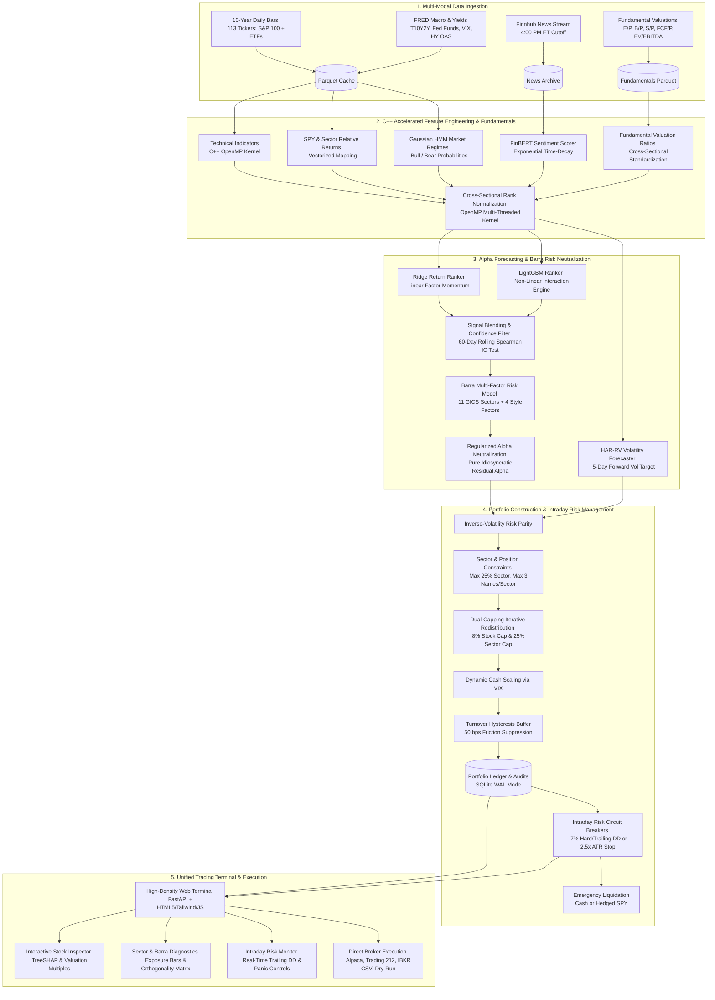

# Argus Quant: Systematic AI Investing Engine

[](https://www.python.org/)
[](https://isocpp.org/)
[](https://www.openmp.org/)
[](https://pytest.org/)
[](LICENSE)

An institutional-grade, multi-modal quantitative investing engine and autonomous trading terminal for systematic stock ranking, risk-managed portfolio allocation, and automated daily execution across the **S&P 100 universe**.

Designed from the ground up for production execution, the system combines **C++ OpenMP accelerated feature engineering**, **multi-modal machine learning** (Ridge, LightGBM, and FinBERT sentiment), **fundamental corporate valuations**, a **Barra multi-factor risk model**, **real-time intraday risk circuit breakers**, **strict capital preservation rules**, and a **high-density unified web trading terminal** (built on FastAPI, HTML5, Tailwind CSS, and Vanilla JavaScript).

---

## Architecture Overview



---

## Key Capabilities

### 1. High-Performance C++ Feature Engine
- **High-Performance C++ Core** (`src/features/fast_features.cpp`): Implements 9 technical indicators (rolling volatilities, Wilder's 14-day RSI, volume z-scores, distance from MA50) and cross-sectional rank normalization using OpenMP multi-threading.
- **Zero-Copy In-Memory Interop** (`src/features/fast_features.py`): Interfaces via Python's standard `ctypes` library, sharing contiguous NumPy array pointers directly in RAM with zero disk serialization and sub-microsecond overhead (< 0.0001 ms).
- **High-Throughput Execution** (278,971 observations across 2,510 trading dates):
  - Computes all technical features and cross-sectional rankings in **~210 ms** on standard multi-core hardware.
  - Generates the complete 10-year research dataset (including disk I/O, target calculations, and regime inference) in **under 1.8 seconds**.

### 2. Fundamental Valuations & Multi-Modal AI Ensemble
- **Fundamental Valuations Pipeline** (`src/data/fundamentals.py`): Sources and calculates corporate valuation multiples: Earnings Yield ($E/P$), Book-to-Price ($B/P$), Sales-to-Price ($S/P$), Free Cash Flow Yield ($FCF/P$), Enterprise Value to EBITDA ($EV/\text{EBITDA}$), Dividend Yield, and Log Market Cap. Includes deterministic sector fallback medians and persistent Parquet caching.
- **Ensemble Return Modeling**: Blends linear Ridge regression with shallow, multi-seed gradient-boosted decision trees (LightGBM) to forecast 5-day forward excess returns against the S&P 500 benchmark.
- **FinBERT NLP Sentiment**: Evaluates news headlines and extracts tone metrics (`sentiment_mean`, `sentiment_dispersion`, `sentiment_3d_mean`) with exponential time-decay weighting.
- **Gaussian HMM Regime Detection**: Classifies market dynamics into `Low Vol Bull`, `High Vol Bear`, or transitional states based on SPY returns and VIX levels.
- **SHAP Attribution**: Decomposes every stock recommendation into human-auditable quantitative drivers via TreeSHAP and LinearSHAP.

### 3. Barra Multi-Factor Neutralization
- **Barra Factor Exposure Matrix** (`src/features/barra.py`): Constructs factor exposure matrix $X \in \mathbb{R}^{N \times 15}$ spanning:
  - 11 binary GICS sector dummies (Information Technology, Health Care, Financials, Consumer Discretionary, Communication Services, Industrials, Consumer Staples, Energy, Utilities, Real Estate, Materials).
  - 4 cross-sectional style factors (Size, Volatility, Momentum, and Value composite score).
- **Regularized Projection Residualization**:
  $$\alpha_{\text{neutral}} = \alpha - X(X^T X + \lambda I)^{-1} X^T \alpha$$
  Uses ridge regularization ($\lambda = 10^{-4}$) to guarantee positive-definite inversion, eliminating systematic sector and style tilts ($\max |\rho| < 10^{-6}$) while preserving rank dispersion and mean scale.

### 4. Intraday Risk Circuit Breakers & Emergency Stop-Losses
- **Continuous Intraday Risk Monitor** (`src/portfolio/risk_monitor.py`):
  - Evaluates open portfolio constituents against entry costs and peak high-water marks (HWM).
  - Triggers emergency liquidation under three defensive rules:
    1. *Hard Drawdown Stop*: $\text{Drawdown}_{\text{entry}} \le -7.0\%$
    2. *Trailing Drawdown Stop*: $\text{Drawdown}_{\text{peak}} \le -7.0\%$ from peak HWM
    3. *ATR Volatility Stop*: $\text{Price} \le \text{Peak} - 2.5 \times \text{ATR}_{14}$
  - **Automated Liquidation Modes**:
    - `cash`: Liquidates shares immediately to cash.
    - `hedged_spy`: Liquidates shares and immediately reinvests proceeds into $SPY$.
  - **Telegram & SQLite Audit**: Dispatches high-priority critical alerts and records immutable event entries in `circuit_breaker_events` and `position_high_water_marks`.

### 5. Institutional Portfolio Construction & Capital Preservation
- **Sector Concentration Limits**: Restricts portfolio holdings to a maximum of 25% in any single GICS sector and at most 3 constituents per sector in the target portfolio.
- **Dual-Capping Iterative Redistribution**: Simultaneously satisfies the 8.0% single-stock cap and 25.0% sector cap through an iterative redistribution algorithm that routes excess weight to uncapped names with available sector headroom.
- **Confidence Light State Machine**: Tracks 60-day out-of-sample Spearman IC. Automatically throttles gross exposure to 50% or switches to 100% cash/SPY if predictive edge decays.
- **Dynamic Cash Scaling**: Scales exposure downward during market volatility spikes: $\text{Scale} = \min(1.0, 20.0 / \text{VIX})$.
- **Turnover Hysteresis Buffer**: Enforces a 50 bps buffer ($[0.60, 0.90)$ holding band) to eliminate execution churn.

### 6. Unified High-Density Web Trading Terminal
- **Modern Web Architecture** (`src/dashboard/server.py`, `src/dashboard/static/`): Fast, lightweight terminal built with FastAPI, HTML5, Tailwind CSS, and Vanilla JavaScript with sub-5ms response times.
- **Terminal Capabilities**:
  - Top telemetry strip: System status, Confidence Light, rolling IC, regime, active broker, and portfolio value.
  - Interactive Stock Inspector: Valuation multiples ($E/P, P/E, B/P, P/B, S/P, P/S, FCF$, $EV/\text{EBITDA}$), technical indicators, and TreeSHAP waterfall charts.
  - Bottom Drawer: Live open positions, sector allocation progress bars vs 25% cap, Barra factor orthogonality matrix, execution logs, and automated order slips.
  - Risk Monitor Drawer: Real-time trailing drawdown matrix, stop floors, caution/breached badges, and global panic liquidation controls.
- **Multi-Broker API Execution**: Seamless order transmission to Alpaca Markets (Paper/Live), Trading 212 (Demo/Live), Interactive Brokers (IBKR TWS Basket CSV), or Dry-Run paper simulation.

---

## Feature Engineering Performance

Evaluated on an 8-core CPU across 10 years of market data (113 tickers, 2,510 dates, 278,971 rows):

| Pipeline Stage | Scope | Execution Time | Throughput | Precision / Bounds |
| :--- | :--- | :--- | :--- | :--- |
| **Technical Indicators** (9 features) | 278,971 rows across 113 tickers | **112.8 ms** | >2.4M features/sec | Finite float guarantees |
| **Cross-Sectional Rank Normalization** (13 features) | 2,510 daily market cross-sections | **97.0 ms** | >3.7M cells/sec | Strict uniform ranking $[0, 1]$ |
| **Total Core Feature Compute** | 10 full years (278,971 observations) | **210 ms** | >1.3M rows/sec | Zero NaN / Inf propagation |
| **Full End-to-End Dataset Build** | Disk I/O, HMM, Targets & Alignments | **1.74 s** | Complete 10-Yr Panel | 249,260 clean observations |

---

## Getting Started

### Prerequisites
- **Linux** (Ubuntu / Debian / RHEL) or **macOS** or **WSL2**
- **Python 3.12+**
- **GCC (g++) 11+** or **Clang** with OpenMP support
- **Make**

### Installation

```bash
# 1. Clone the repository
git clone https://github.com/TheChii/Argus.git
cd Argus

# 2. Create and activate Python 3.12 virtual environment
python3 -m venv .venv
source .venv/bin/activate

# 3. Install Python dependencies
pip install --upgrade pip
pip install -r requirements.txt

# 4. Compile the C++ acceleration core
make -C src/features
```

### Configuration

Copy the example environment file and add your credentials:

```bash
cp .env.example .env
```

Edit `.env`:
```ini
# Macro & News APIs (Optional - automated public fallbacks used if omitted)
FRED_API_KEY=your_fred_api_key_here
FINNHUB_API_KEY=your_finnhub_api_key_here

# Operations Alerts (Telegram Bot API, Optional)
TELEGRAM_BOT_TOKEN=your_telegram_bot_token_here
TELEGRAM_CHAT_ID=your_telegram_chat_id_here

# Broker Execution Engine (dry_run, alpaca, or trading212)
DEFAULT_BROKER=dry_run
ALPACA_API_KEY=your_alpaca_key
ALPACA_SECRET_KEY=your_alpaca_secret
ALPACA_PAPER=true

# Trading 212 API (Demo or Live)
TRADING212_API_KEY=your_trading212_key
TRADING212_API_SECRET=your_trading212_secret
TRADING212_ENV=demo
```

### Container Deployment (Docker & Docker Compose)

Argus Quant is containerized with multi-stage builds, C++ OpenMP compilation, and unprivileged user isolation:

```bash
# Launch terminal with persistent data volume:
docker compose up -d

# Or build and run standalone container:
docker build -t argus-quant:2.3.0 .
docker run -d -p 8501:8501 -v $(pwd)/data:/app/data --env-file .env argus-quant:2.3.0
```

---

## Usage Guide

### 1. Launch the Unified Web Trading Terminal

```bash
# Launch the web terminal on port 8501 (or custom host/port)
python main.py dashboard --host 0.0.0.0 --port 8501
```

Access the interface in your browser at `http://localhost:8501`.

### 2. Historical Data Backfill

```bash
# Backfill 10 years of daily OHLCV bars across the S&P 100 universe + ETFs
python main.py backfill-prices --years 10

# Backfill macroeconomic indicators (72 years of FRED data)
python main.py backfill-macro

# Backfill 1 year of financial news headlines
python main.py backfill-news --days-back 365
```

### 3. Run the Daily Pipeline

```bash
# Run the complete end-of-day workflow: prices, macro, fundamentals, news, FinBERT, alpha ranking, and rebalancing
python main.py run-daily --auto-rebalance --commit-holdings

# Check pipeline status and dataset freshness
python main.py status
```

### 4. Run Benchmarks & Tests

```bash
# Run the feature engineering performance benchmark
python scripts/benchmark_features.py

# Run the complete automated test suite (110 unit & integration tests)
pytest -v
```

---

## CLI Reference

| Command | Arguments | Description |
| :--- | :--- | :--- |
| `dashboard` | `--host 0.0.0.0`, `--port 8501` | Launches the Unified Argus Quant Web Trading Terminal (FastAPI / Tailwind). |
| `run-daily` | `--auto-rebalance`, `--commit-holdings` | Runs full daily pipeline from market data to order generation. |
| `status` | — | Displays universe coverage, cache status, headline count, and data freshness. |
| `backfill-prices` | `--years 10`, `--force` | Synchronizes 10-year daily price panel to Parquet storage. |
| `backfill-macro` | `--force` | Synchronizes FRED macroeconomic indicators. |
| `backfill-news` | `--days-back 365`, `--force` | Ingests news archive with SHA-256 deduplication. |
| `score-headlines` | `--batch-size 32` | Evaluates news headlines through FinBERT sentiment model. |
| `train-baseline` | `--min-train-days 500` | Fits HAR volatility model and evaluates walk-forward Ridge return ranker. |
| `train-lightgbm` | `--min-train-days 500` | Runs walk-forward comparison across Ridge, LightGBM, and 50/50 Blend. |
| `run-sanity-checks`| `--min-train-days 500` | Executes label shuffle and 1-day feature lag tests to confirm zero leakage. |
| `backtest` | `--model blend`, `--cost-bps 7.5` | Executes historical walk-forward cost-adjusted simulation. |
| `report` | `--date YYYY-MM-DD` | Generates or displays the weekly portfolio rebalance report. |
| `update-ledger` | `--seed` | Updates prediction ledger with mature realized returns and recalculates live IC. |
| `export-snapshot` | — | Generates precomputed dashboard snapshot JSON (`today_snapshot.json`). |
| `setup-automation` | — | Displays cron schedule and GitHub Actions production configuration. |

---

## Project Structure

```
Argus/
├── .github/workflows/          # Automated GitHub Actions CI and daily cron workflows
│   ├── ci.yml                  # Continuous integration test runner
│   └── daily_pipeline.yml      # End-of-day automated execution workflow
├── data/                       # Structured data directory (.gitkeep tracked)
│   ├── prices/                 # 10-year OHLCV Parquet files per ticker
│   ├── fundamentals/           # Valuation multiples JSON caches and Parquet panel
│   ├── macro/                  # FRED macroeconomic time series Parquet
│   ├── news/archive/           # Deduplicated Finnhub news headlines
│   ├── scores/                 # FinBERT sentiment scores & model predictions
│   ├── portfolio/              # Target weights and turnover logs
│   ├── dashboard/              # Precomputed snapshot JSON and SQLite ledger
│   └── reports/                # Markdown and PDF weekly reports
├── docs/                       # Technical documentation and system manuals
│   ├── ARGUS_QUANT_SYSTEM_MANUAL.md   # Comprehensive mathematical & algorithmic manual
│   └── ARGUS_QUANT_SYSTEM_MANUAL.pdf  # Institutional PDF specification
├── scripts/
│   ├── benchmark_features.py   # 10-year feature engineering performance benchmark
│   ├── cron_daily.sh           # Linux cron script with flock and log rotation
│   └── systemd/                # Systemd service units (argus-quant-dashboard.service)
├── src/
│   ├── config/                 # Universe definitions (S&P 100, Sector ETFs) and settings
│   ├── data/                   # Data pipelines (prices, FRED macro, fundamentals, news)
│   │   ├── fundamentals.py     # Valuation ratios pipeline with deterministic fallbacks
│   │   ├── prices.py           # Historical price sync and caching
│   │   ├── macro.py            # FRED macroeconomic data ingestion
│   │   └── news/               # News archiver, backfiller, and Finnhub fetcher
│   ├── features/               # Feature engineering module
│   │   ├── fast_features.cpp   # C++17 OpenMP parallel feature kernel
│   │   ├── fast_features.py    # Zero-copy ctypes bindings with Python fallback
│   │   ├── Makefile            # C++ build script (libfast_features.so)
│   │   ├── barra.py            # Barra multi-factor risk model & alpha neutralization
│   │   ├── technical.py        # Technical feature definitions & Wilder's RSI / ATR
│   │   ├── relative.py         # SPY & Sector ETF excess returns
│   │   ├── normalization.py    # Daily cross-sectional rank normalization
│   │   ├── regime.py           # Gaussian Hidden Markov Model regime detector
│   │   └── sentiment.py        # News sentiment aggregation & alignment
│   ├── models/                 # Machine learning models
│   │   ├── return_ranker/      # Ridge and LightGBM models + ensemble
│   │   ├── vol_model/          # HAR-RV forward volatility model
│   │   ├── explainability/     # SHAP tree and linear explainers
│   │   └── sanity_checks.py    # Label shuffle & 1-day lag sanity checks
│   ├── portfolio/              # Risk-managed allocation, circuit breakers & broker API
│   │   ├── allocator.py        # Sizing with 8% stock cap, 25% sector cap & Barra integration
│   │   ├── risk_monitor.py     # Real-time intraday risk circuit breaker monitor
│   │   ├── broker.py           # Alpaca, Trading 212 & Dry-Run execution engine
│   │   └── prediction_ledger.py# Target weight persistence & rolling IC tracker
│   ├── dashboard/              # Fast unified web terminal backend & assets
│   │   ├── app.py              # FastAPI server entrypoint
│   │   ├── server.py           # REST API routes, risk monitor endpoints & static serving
│   │   ├── snapshot.py         # Sub-5ms atomic snapshot builder
│   │   ├── database.py         # SQLite WAL ledger, high-water marks & circuit breaker events
│   │   └── static/             # Native HTML5, Tailwind CSS, and Vanilla JS UI assets
│   └── pipeline.py             # Daily orchestrator with file locking & idempotency
├── tests/                      # Automated test suite (107 tests)
│   ├── test_barra.py           # Barra factor matrix and alpha residualization tests
│   ├── test_fundamentals.py    # Valuation multiples pipeline & caching tests
│   ├── test_risk_monitor.py    # Intraday trailing stop & circuit breaker tests
│   └── ...                     # Comprehensive unit and integration test suite
├── .env.example                # Configuration template
├── main.py                     # Primary CLI entrypoint
├── Makefile                    # Top-level helper targets
├── pytest.ini                  # Pytest configuration
└── requirements.txt            # Python dependencies
```

---

## Production Safeguards

- **Process Concurrency Locking**: Prevents overlapping execution during daily runs using an OS-level file lock (`.pipeline.lock`).
- **Database WAL Mode**: SQLite runs in Write-Ahead Logging (`PRAGMA journal_mode=WAL`) with a 30-second busy timeout to prevent database locks between background daemons and the interactive trading terminal.
- **Defensive Execution Fallback**: If the compiled shared library is ever unavailable or encounters corrupted data, the engine automatically switches to internal fallback routines without throwing unhandled exceptions.
- **Log Rotation**: Automated cron scripts truncate logs at 10 MB, keeping historical rotations.

---

## Testing

The project maintains a comprehensive test suite covering mathematical parity, edge cases, portfolio rules, and end-to-end execution:

```bash
# Run the entire test suite (107 tests)
pytest -v

# Run Barra factor neutralization tests
pytest tests/test_barra.py -v

# Run fundamental valuations tests
pytest tests/test_fundamentals.py -v

# Run intraday risk circuit breaker tests
pytest tests/test_risk_monitor.py -v

# Run fast C++ unit tests
pytest tests/test_fast_features.py -v
```

---

## License & Disclaimer

Distributed under the **MIT License**. See `LICENSE` for more information.

> [!CAUTION]
> **Financial Disclaimer**: This software is designed for educational, research, and algorithmic trading development purposes. Nothing in this repository constitutes investment advice, financial advisory, or a recommendation to buy or sell securities. Past performance in backtests or paper trading does not guarantee future results. Quantitative investing involves the risk of loss. Always perform your own due diligence and consult a licensed financial advisor before deploying real capital.
